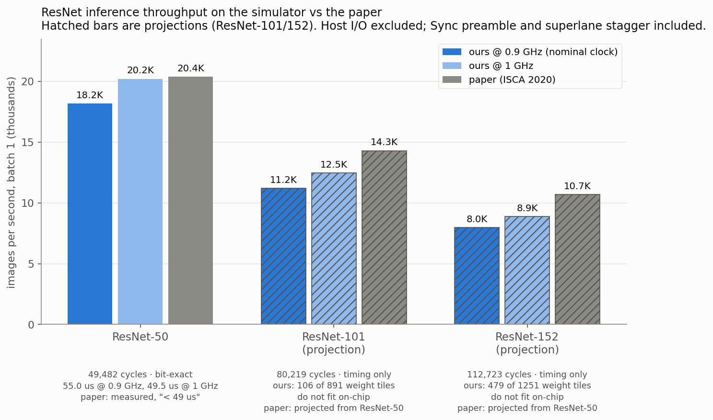
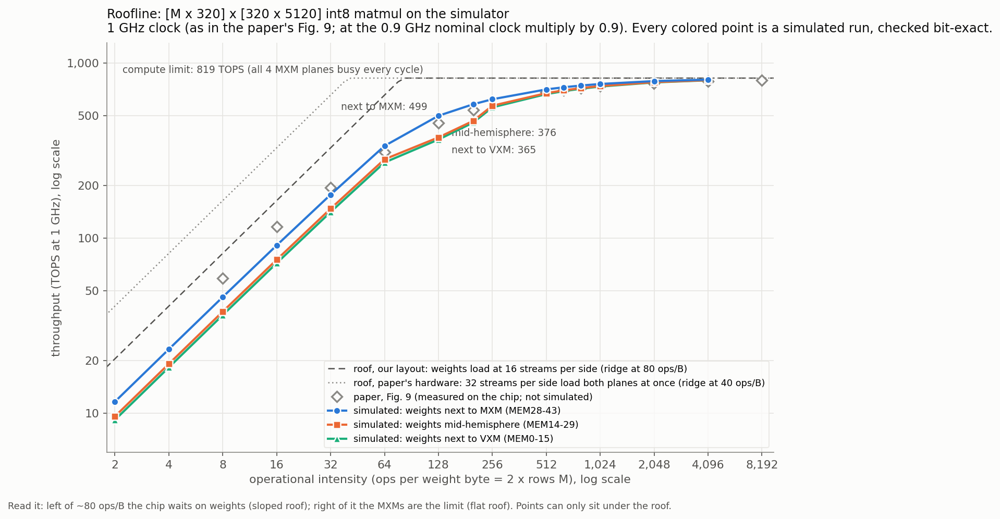
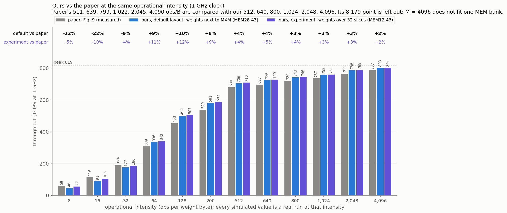
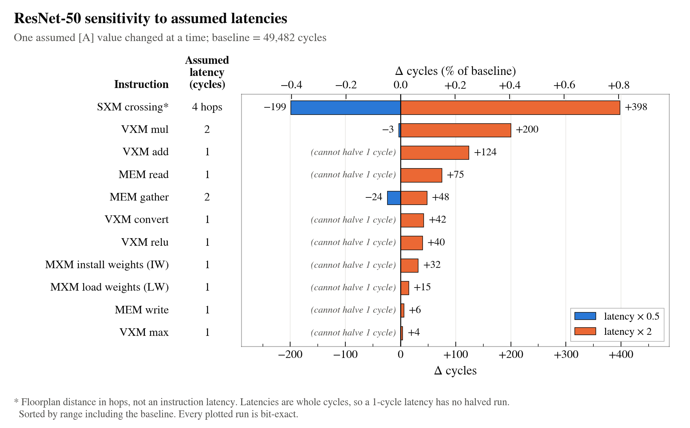

# Results report

Generated by `make` (scripts/reproduce.sh -> scripts/report.py) from the files in `results/`.
Do not edit by hand. Batch 1, host I/O excluded, Sync preamble and superlane stagger included.

Tests: 20 passed, 0 failed (`results/tests.log`).

## ResNet

| model | cycles | IPS @ 0.9 GHz | latency @ 0.9 GHz | IPS @ 1 GHz | paper IPS | check |
|---|---:|---:|---:|---:|---:|---|
| ResNet-50 | 49,482 | 18,188 | 55.0 us | 20,209 | 20,400 | bit-exact, 0 violations, 0 IQ underflows |
| ResNet-101 | 80,219 | 11,219 | 89.1 us | 12,466 | 14,300 | timing-only projection (106 of 891 weight tiles aliased), 0 violations |
| ResNet-152 | 112,723 | 7,984 | 125.2 us | 8,871 | 10,700 | timing-only projection (479 of 1251 weight tiles aliased), 0 violations |

ResNet-50 Ifetch: 195 refills (369 text vectors) on 53 of 116 IQs with code; 73.6 KB of 135.0 KB of text fetched from 369 MEM words (369 read-port cycles); 0 underflows, 0 overflows, max IQ fill 635 B of 640; 42,959 IQ entries on 116 of 144 IQs.

Refills on ResNet-101 / 152: 518 (0 underflows, 0 overflows) / 885 (0 underflows, 0 overflows).

## Sensitivity (ResNet-50)

| run | flag | cycles | vs baseline | check |
|---|---|---:|---:|---|
| baseline | (none) | 49,482 | +0.0% | bit-exact, 0 violations |
| MEM IQ single-issue (Read and Write serialize) | `--mem-single-issue` | 54,563 | +10.3% | bit-exact, 0 violations |
| SXM 14 hops wide per side instead of 4 | `--sxm-hops 14` | 50,244 | +1.5% | bit-exact, 0 violations |
| no layer overlap (each layer waits for the previous) | `--no-layer-overlap` | 55,218 | +11.6% | bit-exact, 0 violations |

## Roofline ([M x 320] x [320 x 5120] int8, `results/roofline.csv`)

Throughput is TOPS at 1 GHz (ops per cycle / 1000), the paper's Fig. 9 axis; at the 0.9 GHz nominal clock multiply by 0.9. Peak = 4 planes x 2 x 320 x 320 = 819.2 TOPS. Cycles run from the first instruction to the last result write (no Sync preamble). 60 simulated points, 60 bit-exact with 0 violations and 0 IQ underflows.

| M | ops/B | weights next to MXM (MEM28-43) | weights mid-hemisphere (MEM14-29) | weights next to VXM (MEM0-15) | weights over 32 slices (MEM12-43) (experiment) |
|---:|---:|---:|---:|---:|---:|
| 1 | 2 | 11.7 (281 cyc) | 9.6 (341 cyc) | 9.2 (357 cyc) | 14.8 (222 cyc) |
| 2 | 4 | 23.2 (282 cyc) | 19.2 (342 cyc) | 18.3 (358 cyc) | 29.0 (226 cyc) |
| 4 | 8 | 46.2 (284 cyc) | 38.1 (344 cyc) | 36.4 (360 cyc) | 56.0 (234 cyc) |
| 8 | 16 | 91.0 (288 cyc) | 75.3 (348 cyc) | 72.0 (364 cyc) | 104.9 (250 cyc) |
| 16 | 32 | 177.1 (296 cyc) | 147.3 (356 cyc) | 140.9 (372 cyc) | 185.9 (282 cyc) |
| 32 | 64 | 336.1 (312 cyc) | 281.9 (372 cyc) | 270.3 (388 cyc) | 341.6 (307 cyc) |
| 64 | 128 | 499.3 (420 cyc) | 375.8 (558 cyc) | 365.4 (574 cyc) | 506.6 (414 cyc) |
| 100 | 200 | 581.0 (564 cyc) | 466.8 (702 cyc) | 456.4 (718 cyc) | 587.2 (558 cyc) |
| 128 | 256 | 620.5 (676 cyc) | 569.9 (736 cyc) | 557.8 (752 cyc) | 626.0 (670 cyc) |
| 256 | 512 | 706.1 (1,188 cyc) | 672.2 (1,248 cyc) | 663.7 (1,264 cyc) | 709.7 (1,182 cyc) |
| 320 | 640 | 726.2 (1,444 cyc) | 697.2 (1,504 cyc) | 689.9 (1,520 cyc) | 729.2 (1,438 cyc) |
| 400 | 800 | 743.0 (1,764 cyc) | 718.6 (1,824 cyc) | 712.3 (1,840 cyc) | 745.6 (1,758 cyc) |
| 512 | 1,024 | 758.5 (2,212 cyc) | 738.4 (2,272 cyc) | 733.3 (2,288 cyc) | 760.5 (2,206 cyc) |
| 1024 | 2,048 | 787.7 (4,260 cyc) | 776.7 (4,320 cyc) | 773.9 (4,336 cyc) | 788.8 (4,254 cyc) |
| 2048 | 4,096 | 803.1 (8,356 cyc) | 797.4 (8,416 cyc) | 795.9 (8,432 cyc) | 803.7 (8,350 cyc) |

Piecewise fit (median residual), weights next to the MXM:
* M <= 32: cycles = 280 + M. Weight-delivery bound: the 16 tiles are 8 per hemisphere, both planes of a hemisphere load from the same 16 weight slices (one read port each), so a hemisphere's 8 LWs run one after another: 8 x 20 = 160 cycles. The other 120 cycles are the lead-in before the first LW and the tail after the last (its ABC, the trip to the VXM, the write).
* M >= 256: cycles = 164 + 4M. MXM bound: 4 rounds of M vectors per plane, back to back.
* The two lines cross at M = 38.7 (77 ops/B).
* weights mid-hemisphere (MEM14-29): +60 cycles at low load, +60 at high load (longer weight path to the MXM).
* weights next to VXM (MEM0-15): +76 cycles at low load, +76 at high load (longer weight path to the MXM).

### Ours vs paper Fig. 9

Paper values from `planning/paper_fig9.csv` (see its header for where they come from). A paper point is compared only where a simulated M has 2M within 1% of its x value.

| paper ops/B | paper TOPS | sim M | ours TOPS (weights next to MXM (MEM28-43)) | ours vs paper | weights over 32 slices (MEM12-43) | vs paper |
|---:|---:|---:|---:|---:|---:|---:|
| 8 | 59 | 4 | 46.2 | -21.8% | 56.0 | -5.1% |
| 16 | 116 | 8 | 91.0 | -21.5% | 104.9 | -9.6% |
| 32 | 194 | 16 | 177.1 | -8.7% | 185.9 | -4.2% |
| 64 | 309 | 32 | 336.1 | +8.8% | 341.6 | +10.5% |
| 128 | 453 | 64 | 499.3 | +10.2% | 506.6 | +11.8% |
| 200 | 540 | 100 | 581.0 | +7.6% | 587.2 | +8.7% |
| 511 | 680 | 256 | 706.1 | +3.8% | 709.7 | +4.4% |
| 639 | 697 | 320 | 726.2 | +4.2% | 729.2 | +4.6% |
| 799 | 720 | 400 | 743.0 | +3.2% | 745.6 | +3.6% |
| 1,022 | 737 | 512 | 758.5 | +2.9% | 760.5 | +3.2% |
| 2,045 | 765 | 1024 | 787.7 | +3.0% | 788.8 | +3.1% |
| 4,090 | 787 | 2048 | 803.1 | +2.0% | 803.7 | +2.1% |

No simulated point for paper x = 8,179 (M = 4096 needs a 4,096-word store in one bank; the largest store is 4,095 words).

### Why ours is below the paper at low operational intensity and above it in the middle

* **Low intensity (-22% at 8, -22% at 16 ops/B).** Below the crossover our time is almost flat (280 + M cycles): it is set by loading weights, not by compute. Our lowering [Ours] puts all weight tiles in 16 slices per hemisphere (MEM28-43), so the two planes of a hemisphere share 16 read ports and take turns loading. The paper's hardware loads both at once: "using all 32 streams in each direction allows us to emplace weights in both MXM planes simultaneously on both MXM hemispheres, loading all 409,600 weights on-chip in less than 40 cycles" (ISCA 2020 p.152; the same text is in patent US 11,822,510). Our layout needs 40 cycles plus transit for the same load. Spreading the weights over 32 slices (weights over 32 slices (MEM12-43)), so the two planes' LWs can partly overlap, is the experiment that tests this: it cuts the gap to -5% at 8, -10% at 16 ops/B and leaves high intensity unchanged. So most of the low-intensity gap is our weight layout, not the hardware timing model. It does not close fully because the two planes' loads still overlap only partly in that layout, and the pipeline tail of a one-shot run (the last tile's ABC d_func 20 [I], the trip to the VXM, the write) is never hidden.
* **Middle intensity (up to +10% at 128 ops/B).** Above the crossover our time is 164 + 4M cycles: the scheduler hides the next tile's LW completely behind the current ABC and leaves no bubble between rounds, so our curve is max(weight-bound, MXM-bound) plus a fixed tail, with a sharp knee at 77 ops/B. The paper's curve bends gradually over the same range. We cannot see the paper's schedule, so this is an inference: its compiled programs lose some cycles near the knee (imperfect LW/ABC overlap, gaps between rounds) where ours lose none, which puts our overestimate just past the knee. It is not the weight placement: the 32-slice experiment is +12% at the same load. Our perfect overlap rests on the assumed [A] 1-cycle weight install (IW) between rounds; the test below shows that a longer IW closes this gap.
* **High intensity (+3%, +3%, +2% from 1,022 ops/B up).** Both curves approach the 819 TOPS peak; only our 164-cycle fixed tail is left, so the gap shrinks.

### Testing the weight-swap explanation (`results/roofline_iw10.csv`)

The same sweep with the weight install (IW) at 10 cycles instead of 1 (`roofline --lat mxm_iw=10`), weights next to the MXM. Every point is bit-exact with 0 violations.

| paper ops/B | paper TOPS | ours, IW = 1 | vs paper | ours, IW = 10 | vs paper |
|---:|---:|---:|---:|---:|---:|
| 8 | 59 | 46.2 | -21.8% | 41.0 | -30.6% |
| 16 | 116 | 91.0 | -21.5% | 80.9 | -30.3% |
| 32 | 194 | 177.1 | -8.7% | 157.9 | -18.6% |
| 64 | 309 | 336.1 | +8.8% | 301.3 | -2.5% |
| 128 | 453 | 499.3 | +10.2% | 459.9 | +1.5% |
| 200 | 540 | 581.0 | +7.6% | 546.1 | +1.1% |
| 511 | 680 | 706.1 | +3.8% | 685.3 | +0.8% |
| 639 | 697 | 726.2 | +4.2% | 708.5 | +1.6% |
| 799 | 720 | 743.0 | +3.2% | 728.2 | +1.1% |
| 1,022 | 737 | 758.5 | +2.9% | 746.3 | +1.3% |
| 2,045 | 765 | 787.7 | +3.0% | 781.1 | +2.1% |
| 4,090 | 787 | 803.1 | +2.0% | 799.7 | +1.6% |

With IW = 10, every point from 64 ops/B up is within 2.5% of the paper (-2.5% to +2.1%), against up to +10.2% with IW = 1. So a weight install of about 10 cycles on the real chip would explain the middle-intensity gap: 4 rounds x ~10 cycles matches the ~40 extra cycles the paper spends there. The value 10 was chosen because it fits; the paper does not publish the IW latency, so this is an estimate, not a measurement. At low intensity a longer IW widens the gap (-31% at 8, -30% at 16), because there the weight path is the bottleneck; that end is the separate weight-layout effect above.

## Latency sensitivity (ResNet-50, `results/latency_sensitivity.csv`)

Each assumed [A] value halved and doubled on its own (`scripts/sensitivity.py`); baseline 49,482 cycles. Every run is bit-exact with 0 violations. Latencies are whole cycles, so a 1-cycle value has no halved run.

| value | tag | assumed | halved | doubled | range |
|---|---|---:|---:|---:|---:|
| SXM crossing | A | 4 hops | -199 (-0.40%) | +398 (+0.80%) | 597 |
| VXM mul | A | 2 | -3 (-0.01%) | +200 (+0.40%) | 203 |
| VXM add | A | 1 | n/a | +124 (+0.25%) | 124 |
| MEM read | A | 1 | n/a | +75 (+0.15%) | 75 |
| MEM gather | A | 2 | -24 (-0.05%) | +48 (+0.10%) | 72 |
| VXM convert | A | 1 | n/a | +42 (+0.08%) | 42 |
| VXM relu | A | 1 | n/a | +40 (+0.08%) | 40 |
| MXM install weights (IW) | A | 1 | n/a | +32 (+0.06%) | 32 |
| MXM load weights (LW) | A/P | 1 | n/a | +15 (+0.03%) | 15 |
| MEM write | A | 1 | n/a | +6 (+0.01%) | 6 |
| VXM max | A | 1 | n/a | +4 (+0.01%) | 4 |

No instruction latency moves ResNet-50 by more than 0.4% (VXM mul, +200 cycles); the SXM width, a floorplan distance, matters most. This sweep is ResNet-50 only: it does not test the roofline's middle-intensity gap.

